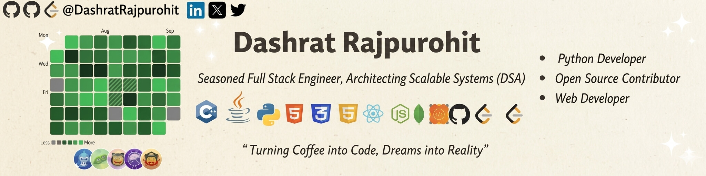
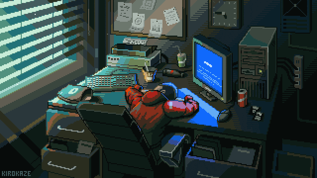

<!-- Profile README for Dashrat Rajpurohit -->

  

  

  
  
  
  

  
  
  
  

  <a href="#-about-me">About</a> &nbsp;·&nbsp;
  <a href="#-open-source">Open source</a> &nbsp;·&nbsp;
  <a href="#-featured-projects">Projects</a> &nbsp;·&nbsp;
  <a href="#-tech-stack">Tech stack</a> &nbsp;·&nbsp;
  <a href="#-github-stats">Stats</a> &nbsp;·&nbsp;
  <a href="#-interactive-corner">Play & sign</a>

## 🐱 About me

<table>
  <tr>
    <td width="56%" valign="top">

I'm a **Computer Science Engineering student at CodingGita × Swaminarayan University** (batch 2025–29), from Jodhpur, Rajasthan . I like the part of software where design and development meet: take a rough idea, shape the interface, then ship it end to end.

- 🌱 Building with **React, JavaScript and Node.js**
- 🧭 Turning vague requirements into shipped user flows
- 🌍 Contributing to **Headlamp**, **Phoenix** and **eventyay**
- 🛠️ Obsessed with DX: linting, tests, one-click deploys
- 🧩 Practising DSA in **C++** in my [Leetcode](https://github.com/DashratRajpurohit/Leetcode) repo
- 🤝 I ship faster with a teammate, so ping me!

</td>
    <td width="44%" align="center" valign="middle">
      
    </td>
  </tr>
</table>

| 🔭 Working on | ⚡ Exploring | 💬 Ask me about | ☕ Motto |
| :-- | :-- | :-- | :-- |
| Phoenix event display (HSF) and the AI pipeline for Samadhan Setu (SIH 2026) | Performance profiling on React + Node, and testing setups that actually get used | React, the MERN stack, and landing your first open-source PR | *Turning coffee into code, dreams into reality* |

## 🌍 Open source

Merged pull requests in some larger open-source projects:

| Project | What I did | PRs |
| :-- | :-- | :-- |
|  **[Headlamp](https://github.com/kubernetes-sigs/headlamp)** Kubernetes SIGs · Kubernetes web UI  | Fixed owner-reference resolution (match on `apiVersion` + `kind`) so resources link to the right object, and swapped a linear scan for a `Map` in recent-cluster lookup | [#5641](https://github.com/kubernetes-sigs/headlamp/pull/5641) [#5686](https://github.com/kubernetes-sigs/headlamp/pull/5686) |
|  **[Phoenix](https://github.com/HSF/phoenix)** HEP Software Foundation · event display for particle physics  | Synced the Eta-Phi view with the 3D view's visibility and cuts, added generic loading of zipped event data, and documented the dataset browser and loaders | [#966](https://github.com/HSF/phoenix/pull/966) [#967](https://github.com/HSF/phoenix/pull/967) [#1040](https://github.com/HSF/phoenix/pull/1040) |
|  **[eventyay](https://github.com/fossasia/eventyay)** FOSSASIA · event management and ticketing  | Added WCAG contrast validation for event design colours, fixed an LSP violation in the ticket-secret generator, and fixed wrong language flags in event settings | [#3853](https://github.com/fossasia/eventyay/pull/3853) [#3877](https://github.com/fossasia/eventyay/pull/3877) [#3991](https://github.com/fossasia/eventyay/pull/3991) |
|  **[SHAP](https://github.com/shap/shap)** Explainable machine learning  | Clarified the `expected_value` formula in the TreeExplainer docs | [#4418](https://github.com/shap/shap/pull/4418) |

  <a href="https://github.com/search?q=author%3ADashratRajpurohit+is%3Apr+-user%3ADashratRajpurohit&type=pullrequests"><b>All my pull requests →</b></a>

## 🚀 Featured projects

<table>
  <tr>
    <td width="50%" valign="top">

### 🏛️ Indian Law Penal Code Dashboard

A full-stack MERN dashboard for searching, filtering and analysing Indian penal-code records, with JWT auth and token revocation, an admin suite, analytics endpoints and a neo-brutalist UI. My semester-2 project, with 70+ commits.

[**Live demo ↗**](https://indian-law-penal.vercel.app/) · [Code](https://github.com/codinggita/indian_law_penal_code_dashrat_rajpurohit)

</td>
    <td width="50%" valign="top">

### 🧠 Samadhan Setu (SIH 2026)

A civic-issue platform for Jharkhand: citizens report problems, AI triages them, and universities propose fixes. I built the web frontend and the AI pipeline, including an NVIDIA NIM worker with a 35 RPM rate limiter.

[**Live demo ↗**](https://amrit-raj50.github.io/PS/) · [Code](https://github.com/himmatmundhe07/Samadhan_Setu)

</td>
  </tr>
  <tr>
    <td width="50%" valign="top">

### 🐾 Rescue+

An emergency animal-rescue and adoption platform that connects people with nearby rescue services. Team project; I made 45+ commits across the app.

[**Live demo ↗**](https://rescue-plus.vercel.app) · [Code](https://github.com/codinggita/ressuenet)

</td>
    <td width="50%" valign="top">

### 🎙️ AI Browser Companion

A 31-hour hackathon build with a team of four: a Chrome extension that reads, understands and talks about any webpage. I worked on the backend and the LLM integration.

[Code](https://github.com/codinggita/runtime_error)

</td>
  </tr>
</table>

  <b>More:</b>
  <a href="https://dashrat-108682-instamart-25sep.netlify.app">Instamart clone</a> ·
  <a href="https://htm-css-projects.netlify.app/">HTML/CSS projects</a> ·
  <a href="https://js-project-dashrat.netlify.app/">JavaScript projects</a> ·
  <a href="https://github.com/DashratRajpurohit/MacOS-Portfolio">macOS-style portfolio</a> ·
  <a href="https://github.com/DashratRajpurohit/FALLING-PICKEX">Falling Pickaxe (Python game)</a>
  

## 🧰 Tech stack

  <picture>
    <source media="(prefers-color-scheme: dark)" srcset="assets/tech-stack-dark.svg" />
    
  </picture>

## 📊 GitHub stats

  <picture>
    <source media="(prefers-color-scheme: dark)" srcset="https://github-readme-stats.vercel.app/api?username=DashratRajpurohit&show_icons=true&rank_icon=github&border_radius=10&bg_color=0d1117&title_color=3fb950&icon_color=3fb950&text_color=c9d1d9&ring_color=3fb950&border_color=30363d" />
    
  </picture>
  <picture>
    <source media="(prefers-color-scheme: dark)" srcset="https://github-readme-stats.vercel.app/api/top-langs/?username=DashratRajpurohit&layout=compact&langs_count=8&border_radius=10&bg_color=0d1117&title_color=3fb950&text_color=c9d1d9&border_color=30363d" />
    
  </picture>

  <picture>
    <source media="(prefers-color-scheme: dark)" srcset="https://streak-stats.demolab.com?user=DashratRajpurohit&border_radius=10&background=0D1117&border=30363D&stroke=30363D&ring=3FB950&fire=3FB950&currStreakNum=C9D1D9&sideNums=C9D1D9&currStreakLabel=3FB950&sideLabels=8B949E&dates=8B949E" />
    
  </picture>

  <picture>
    <source media="(prefers-color-scheme: dark)" srcset="https://github-trophies.vercel.app/?username=DashratRajpurohit&theme=darkhub&no-frame=true&no-bg=true&row=1&column=7&margin-w=8" />
    
  </picture>

  <picture>
    <source media="(prefers-color-scheme: dark)" srcset="https://raw.githubusercontent.com/DashratRajpurohit/DashratRajpurohit/output/profile-3d-contrib/profile-night-green.svg" />
    
  </picture>

<b>More stats</b>

 

  <picture>
    <source media="(prefers-color-scheme: dark)" srcset="https://github-profile-summary-cards.vercel.app/api/cards/profile-details?username=DashratRajpurohit&theme=github_dark" />
    
  </picture>

  <picture>
    <source media="(prefers-color-scheme: dark)" srcset="https://github-profile-summary-cards.vercel.app/api/cards/most-commit-language?username=DashratRajpurohit&theme=github_dark" />
    
  </picture>
  <picture>
    <source media="(prefers-color-scheme: dark)" srcset="https://github-profile-summary-cards.vercel.app/api/cards/productive-time?username=DashratRajpurohit&theme=github_dark&utcOffset=5.5" />
    
  </picture>

### 🐍 Contribution snake

  <picture>
    <source media="(prefers-color-scheme: dark)" srcset="https://raw.githubusercontent.com/DashratRajpurohit/DashratRajpurohit/output/github-contribution-grid-snake-dark.svg" />
    
  </picture>

## 🎯 Interactive corner

Everything here runs on GitHub Issues and Actions, so you can play, sign and ask without leaving GitHub.

### 🎮 Play with me

Tic-tac-toe against my bot. Click an empty square, press **Create** on the issue that opens, and the bot plays back. The board below updates in about a minute. Everyone shares one board, so you're teaming up with every other visitor.

<!-- TICTACTOE:START -->

<table>
<tr><td></td><td></td><td></td></tr>
<tr><td></td><td></td><td></td></tr>
<tr><td></td><td></td><td></td></tr>
</table>

<b>Game in progress · moves by <a href="https://github.com/DashratRajpurohit">@DashratRajpurohit</a></b>

👥 Visitors 0 · 🤖 Bot 0 · 🤝 Draws 0 Recent moves: <a href="https://github.com/DashratRajpurohit">@DashratRajpurohit</a> → 5 🏆 Top players: <a href="https://github.com/DashratRajpurohit">@DashratRajpurohit</a> (1)

<!-- TICTACTOE:END -->

### 📝 Guestbook

  

<!-- GUESTBOOK:START -->

No signatures yet. Be the first!

<!-- GUESTBOOK:END -->

### 💬 Ask me anything

Curious about React, the MERN stack, open source or college life? Ask away and I'll answer in the issue.

  
  

### 🐾 My GitAnimals

My pets level up every time I commit.

  

## 😄 Fun corner

  <picture>
    <source media="(prefers-color-scheme: dark)" srcset="https://quotes-github-readme.vercel.app/api?type=horizontal&theme=github" />
    
  </picture>
  <picture>
    <source media="(prefers-color-scheme: dark)" srcset="https://readme-jokes.vercel.app/api?bgColor=%230d1117&textColor=%23c9d1d9&qColor=%233fb950&aColor=%23c9d1d9&borderColor=%2330363d" />
    
  </picture>

### 👀 Profile views

  

<i>Where creativity meets the beauty in code</i>

